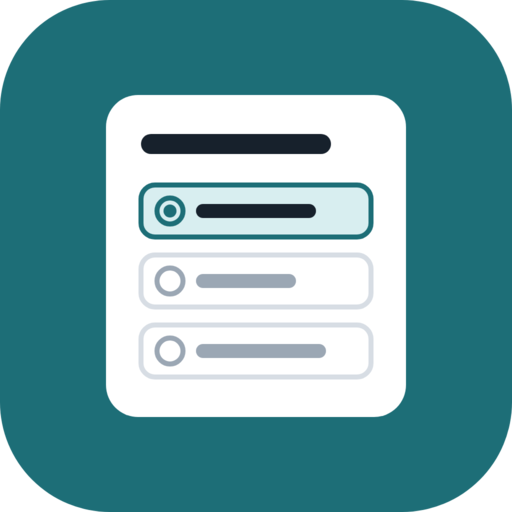
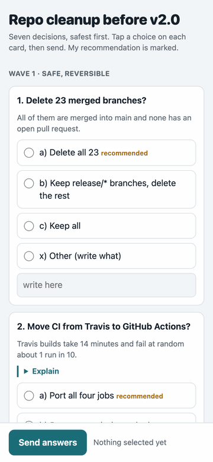
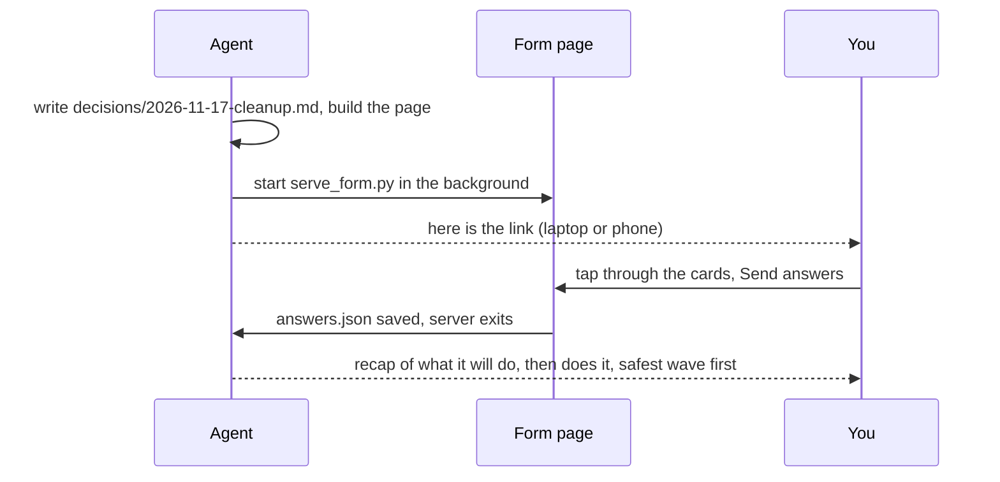
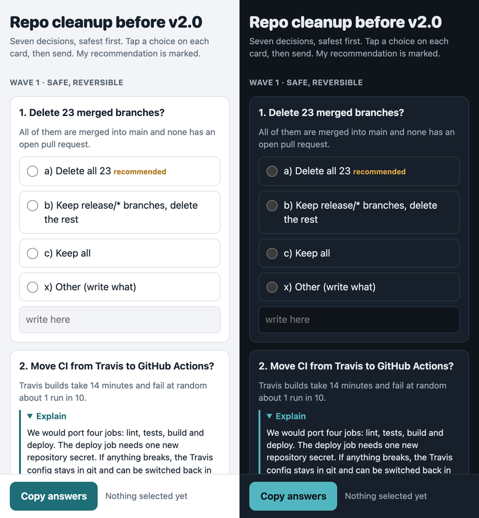

<p align="center">
  
</p>

<h1 align="center">decision-form</h1>

<p align="center">
  <b>Stop answering seven questions buried in one chat message.</b><br>
  Your coding agent turns its open decisions into one page of tappable cards, on your laptop or your phone,<br>
  and waits for your answers before it touches anything.
</p>

<p align="center">
  
  
  
  
  
</p>

<p align="center">
  
</p>

## Install in two lines

```text
/plugin marketplace add martinandrt/decision-form
/plugin install decision-form@decision-form
```

That's it. Next time your agent has three or more decisions for you, or is about to do something hard to undo,
it builds a form instead of a wall of text. You can also just say *"make me a decision form for this"*.

## What you get

- **One card per decision.** The question, one line on what is at stake (including the downside), the agent's
  recommendation marked, an "Explain" fold for the details, and "Other" with a text field on every card.
- **The agent actually waits.** A tiny local server runs in the background; when you tap *Send answers* it saves
  `answers.json` and exits, and the agent picks it up on its own. No copy-paste, no polling.
- **Answer from your phone.** `--lan` gives you a link for your phone on the same Wi-Fi. Decide on the couch,
  the agent continues at the desk.
- **Works without the server too.** Open the HTML file, tap *Copy answers*, paste `1a 2c 3x: ask QA first`
  into the chat.
- **A decision record for free.** The questions (`.md`), the page (`.html`) and your answers (`.answers.json`)
  stay side by side in `decisions/`.
- **Nothing leaves your machine.** One self-contained HTML file, no CDN, no fonts to fetch, no tracking. Python
  standard library only. Light and dark mode.

## How it works



Unanswered questions are asked about, never filled in with the agent's own guess.

## A card, as the agent wrote it

Unedited output of a fresh agent (Claude Haiku) that had only this skill and the task *"decide language,
license, CI and registry for a new CLI"*:

```markdown
### Which license: MIT or Apache-2.0?
Both let anyone use, change and sell the code. Changing the license is hard once outside contributors
have sent code, so decide before that happens. Downside of MIT: it says nothing about patents.
> MIT is one short paragraph and the most common license for small tools. Apache-2.0 is longer. It adds
> an explicit patent license from every contributor and ends that license for anyone who sues over the code.
> It cannot be combined with GPLv2 code, which rarely matters for a new CLI.
- MIT: short, and the most common for small tools *
- Apache-2.0: explicit patent grant, better if companies will contribute
```

The skill teaches the agent how to write these: plain words instead of jargon, the downside next to the benefit,
exactly one recommendation, and reversible decisions before irreversible ones.

## Why not just chat, or the built-in question tool?

|                                | Wall of text in chat | Built-in question tool (AskUserQuestion) | decision-form |
| ------------------------------ | -------------------- | ---------------------------------------- | ------------- |
| Questions at once              | any, hard to track   | 1 to 4                                   | any, grouped in waves |
| Agent's recommendation         | buried in prose      | by convention                            | on every card |
| What is at stake               | mixed in             | short description                        | one line + "Explain" |
| Answer from your phone         | no                   | no                                       | yes |
| Record of what was decided     | scrollback           | scrollback                               | `.md` + `.answers.json` |

For one or two quick questions, the built-in tool is the right choice. The skill says so too.

## Try it without an agent

```bash
git clone https://github.com/martinandrt/decision-form && cd decision-form
python3 skills/decision-form/scripts/serve_form.py examples/repo-cleanup.html --open
```

Tap through, send, and the answers print in your terminal:

```text
Answers: 1a 2a 3b 4a 5a 6x: Ask the QA team first 7a
  1. Delete 23 merged branches? -> a) Delete all 23
  2. Move CI from Travis to GitHub Actions? -> a) Port all four jobs
  3. Drop Node 18 support? -> b) Keep it one more release with a warning
  ...
Saved: examples/repo-cleanup.answers.json
```

## Other ways to install

**Copy the skill** (personal skills, all projects):

```bash
git clone https://github.com/martinandrt/decision-form
cp -R decision-form/skills/decision-form ~/.claude/skills/
```

From the shell instead of a session: `claude plugin marketplace add martinandrt/decision-form` and
`claude plugin install decision-form@decision-form`.

**Other agents** that read Agent Skills: copy `skills/decision-form` into the folder your agent loads skills
from (for example `~/.agents/skills/` or `.cursor/skills/`). Only Claude Code is tested so far.

## Write a form by hand

```markdown
# Repo cleanup before v2.0
Seven decisions, safest first. Tap a choice on each card, then send.

## Wave 1 · safe, reversible
### Delete 23 merged branches?
All of them are merged into main and none has an open pull request.
> Longer explanation, hidden behind "Explain".
- Delete all 23 *
- Keep release/* branches, delete the rest
- Keep some of them (write which) [write]
```

```bash
python3 skills/decision-form/scripts/build_form.py my-decisions.md          # -> my-decisions.html
```

`#` title · line under it = intro · `##` group · `###` question · plain line = what is at stake · `>` = explanation ·
`- option` · trailing `*` = recommended · `[write]` = text field. JSON input works too (`--syntax` shows both).
Czech interface: `--lang cs`.

<p align="center"></p>

## Privacy and safety

- The page makes no network requests; your answers stay on your machine.
- The server listens on `127.0.0.1` by default and every request needs the random token from the printed link.
- `--lan` opens it to your local network over plain HTTP. Use it only on a network you trust.
- The server accepts one submission and exits. With no answer in 60 minutes (`--timeout`) it exits with code 2.
- Tapping *Send* with questions still open asks for a second tap, so a stray tap can't send half a form.

## Background

I built this for my own daily work with Claude Code: about 130 forms since August 2026, for cleanups,
refactors, architecture calls and anything I didn't want decided by accident. The card-writing rules in
[`SKILL.md`](skills/decision-form/SKILL.md) come from that use.

Tests: `python3 -m unittest discover tests` (the server tests need to bind a local port).

## License

MIT, see [LICENSE](LICENSE).
